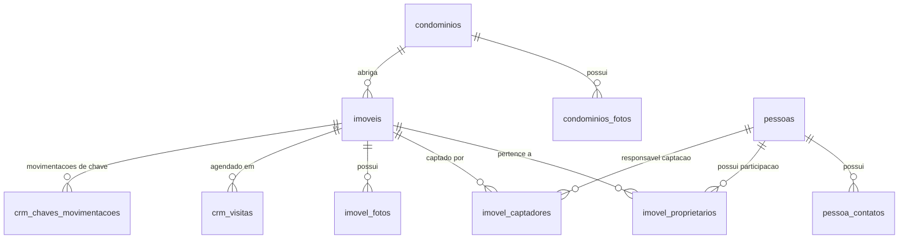
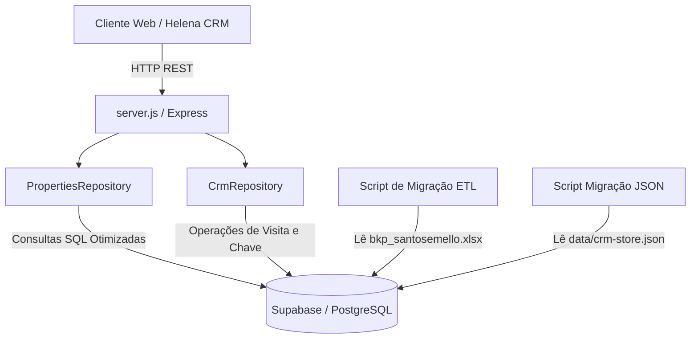

# PRD - Migração Arquitetural: Feed XML Imoview para Banco de Dados Proprietário (PostgreSQL / Supabase)

**Projeto:** `busca-imoveis-santos-mello`  
**Branch de Trabalho:** `develop`  
**Status:** Em Revisão Arquitetural  
**Data:** 23 de Outubro de 2026  
**Autor:** Engenharia de Software / Pair Programming Antigravity  

---

## 1. Visão Geral e Objetivos do Produto

### 1.1 Contexto Atual
Atualmente, o sistema `busca-imoveis-santos-mello` consome um feed público em XML gerado pelo CRM Imoview (`santosemello-vivareal-8835-ambos.xml`). O servidor Node.js (`server.js`) faz o download periódico desse arquivo de vários megabytes, processa-o em memória (`listingsMap` e `listingsList`) e mantém dados operacionais de visitas e claviculário em um arquivo JSON local (`data/crm-store.json`).

### 1.2 Problema
1. **Dependência Crítica de Terceiros:** A imobiliária Santos & Mello está descontinuando o uso do software Imoview. Assim que a conta for encerrada, o feed XML será desligado, paralisando a busca, agendamento de visitas, emissão de propostas e integração com o Helena CRM.
2. **Dados Incompletos no Feed:** O XML do VivaReal omite dados estratégicos do negócio, como informações de contato dos proprietários, captadores responsáveis, percentuais de corretagem e histórico de matrículas/cartório.
3. **Persistência Frágil:** O arquivo `crm-store.json` em disco local não possui escalabilidade nem concorrência transacional robusta para ambientes serverless ou múltiplos nós de aplicação.

### 1.3 Objetivo
Criar uma **estrutura de dados proprietária** baseada em **PostgreSQL / Supabase**, migrando todo o acervo histórico contido no dump oficial (`bkp_santosemello.xlsx`), tornando o sistema totalmente autônomo, seguro e independente do Imoview.

### 1.4 Delimitação de Escopo

#### No Escopo (In-Scope):
* **Modelagem e Criação do Banco Relacional:** Tabelas otimizadas com chaves estrangeiras, índices e constraints para Imóveis, Pessoas, Contatos, Fotos, Condomínios, Proprietários e Captadores.
* **ETL da Planilha Oficial:** Script de importação em lote (`scripts/migrate-xlsx-to-supabase.js`) para carregar:
  * 8.991 Imóveis cadastrados;
  * 56.731 Pessoas e 56.756 telefones/e-mails;
  * 2.060 Condomínios;
  * 173.342 URLs de fotos vinculadas aos imóveis;
  * Vínculos de Proprietários e Captadores com percentuais.
* **Refatoração do Backend (`server.js`):** Substituição da leitura do XML por uma camada de repositório (`lib/repositories/properties-repository.js`) conectada ao Supabase/PostgreSQL.
* **Preservação dos Endpoints REST:** Garantir compatibilidade 100% retroativa com os endpoints consumidos pelo frontend e pelo Helena CRM:
  * `GET /api/imoveis`
  * `GET /api/imovel/:codigo`
  * `POST /api/crm/agendar-visita`
  * `GET /api/crm/claviculario`
  * `GET /api/proposta/dados`
* **Migração do CRM Store:** Transferência dos dados operacionais de visitas agendadas e movimentação de chaves (`data/crm-store.json`) para tabelas no banco de dados.

#### Fora de Escopo (Explicitamente Descartado / Adiado):
* ❌ **Módulos de Atendimento:** As abas `Atendimentos` (5.893 leads), `Atendimentos_Visitas` (783 registros) e `Atendimentos_Propostas` (238 registros) da planilha antiga serão **descartadas**, pois o CRM operacional já é gerido via Helena CRM.
* ⏸️ **Migração Física dos Arquivos de Imagem:** A transferência física das 173 mil imagens do S3 da Imoview para storage próprio (Supabase Storage, Cloudflare R2 ou AWS S3) foi **postergada para uma fase futura** (daqui a algumas semanas). Na fase atual, o banco armazenará a `url_original` e manterá o campo `url_propria` preparado como fallback automático.

---

## 2. Requisitos do Sistema

### 2.1 Requisitos Funcionais (RF)
* **RF01 - Catálogo de Imóveis Autônomo:** O sistema deve consultar, filtrar e ordenar imóveis diretamente do PostgreSQL.
* **RF02 - Riqueza Cadastral:** O sistema deve expor dados operacionais antes inacessíveis pelo XML, em especial `local_chave` (imobiliária, proprietário, portaria), código de chaves, dados de condomínio e dados de captação.
* **RF03 - Busca Textual e Filtros Avançados:** Filtros por finalidade (Venda/Locação), tipo de imóvel, faixa de valor, número de quartos, suítes, vagas, bairro e cidade.
* **RF04 - Gestão de Chaves e Claviculário:** Manter registro seguro de retiradas e devoluções de chaves diretamente na base de dados.
* **RF05 - Agendamento de Visitas:** Gravação das visitas associadas ao código do imóvel, sessão do Helena CRM e dados do cliente.
* **RF06 - Script de Migração Resiliente:** Script de carga com checkpoints, tratamento de serial date do Excel e inserção em lotes (`batch upsert`) de 500 a 1000 registros para evitar timeouts.

### 2.2 Requisitos Não-Funcionais (RNF)
* **RNF01 - Tempo de Resposta:** Tempo de busca de imóveis (`/api/imoveis`) < 150ms com uso de paginação (`limit`/`offset`) e índices adequados.
* **RNF02 - Integridade Referencial:** Chaves estrangeiras com regras claras de integridade (`ON DELETE CASCADE` para fotos e vínculos de proprietários).
* **RNF03 - Disponibilidade das Imagens:** Fallback transparente: se `url_propria` for nula, usar `url_original`.
* **RNF04 - Isolamento em Branch:** Todas as modificações de código e infraestrutura devem permanecer estritamente na branch `develop` até aprovação e homologação final.

---

## 3. Modelo de Dados Relacional (PostgreSQL / Supabase DDL)

### 3.1 Diagrama Entidade-Relacionamento (ERD)



### 3.2 Especificação DDL das Tabelas

```sql
-- Habilita extensão para geração de UUID
CREATE EXTENSION IF NOT EXISTS "uuid-ossp";

-- 1. TABELA DE PESSOAS (Proprietários, Captadores, Clientes)
CREATE TABLE IF NOT EXISTS pessoas (
    codigo_pessoa INTEGER PRIMARY KEY,
    codigo_auxiliar VARCHAR(100),
    nome VARCHAR(255) NOT NULL,
    cpf_cnpj VARCHAR(30),
    tipo_pessoa VARCHAR(10) DEFAULT 'PF', -- 'PF' ou 'PJ'
    numero_documento VARCHAR(50),
    data_emissao_documento DATE,
    data_nascimento DATE,
    estado_civil VARCHAR(50),
    sexo VARCHAR(20),
    nacionalidade VARCHAR(100),
    profissao VARCHAR(150),
    renda_mensal NUMERIC(15, 2),
    endereco VARCHAR(255),
    numero VARCHAR(50),
    complemento VARCHAR(100),
    bairro VARCHAR(100),
    cidade VARCHAR(100),
    cep VARCHAR(20),
    anotacoes TEXT,
    created_at TIMESTAMPTZ DEFAULT NOW(),
    updated_at TIMESTAMPTZ DEFAULT NOW()
);

CREATE INDEX IF NOT EXISTS idx_pessoas_cpf_cnpj ON pessoas(cpf_cnpj);
CREATE INDEX IF NOT EXISTS idx_pessoas_nome ON pessoas(nome);

-- 2. TABELA DE CONTATOS DAS PESSOAS
CREATE TABLE IF NOT EXISTS pessoa_contatos (
    id UUID PRIMARY KEY DEFAULT uuid_generate_v4(),
    codigo_pessoa INTEGER NOT NULL REFERENCES pessoas(codigo_pessoa) ON DELETE CASCADE,
    email VARCHAR(255),
    telefone VARCHAR(50),
    tipo_contato VARCHAR(50) DEFAULT 'principal',
    created_at TIMESTAMPTZ DEFAULT NOW()
);

CREATE INDEX IF NOT EXISTS idx_pessoa_contatos_pessoa ON pessoa_contatos(codigo_pessoa);
CREATE INDEX IF NOT EXISTS idx_pessoa_contatos_tel ON pessoa_contatos(telefone);

-- 3. TABELA DE CONDOMÍNIOS
CREATE TABLE IF NOT EXISTS condominios (
    codigo_condominio INTEGER PRIMARY KEY,
    nome VARCHAR(255) NOT NULL,
    tipo VARCHAR(100),
    destinacao VARCHAR(100),
    construtora VARCHAR(255),
    cep VARCHAR(20),
    endereco VARCHAR(255),
    numero VARCHAR(50),
    bairro VARCHAR(100),
    cidade VARCHAR(100),
    ponto_referencia TEXT,
    latitude NUMERIC(10, 8),
    longitude NUMERIC(11, 8),
    ano_construcao INTEGER,
    descricao TEXT,
    anotacoes TEXT,
    cartorio VARCHAR(150),
    matricula VARCHAR(100),
    created_at TIMESTAMPTZ DEFAULT NOW(),
    updated_at TIMESTAMPTZ DEFAULT NOW()
);

CREATE INDEX IF NOT EXISTS idx_condominios_cidade_bairro ON condominios(cidade, bairro);

-- 4. FOTOS DE CONDOMÍNIOS
CREATE TABLE IF NOT EXISTS condominio_fotos (
    id UUID PRIMARY KEY DEFAULT uuid_generate_v4(),
    codigo_condominio INTEGER NOT NULL REFERENCES condominios(codigo_condominio) ON DELETE CASCADE,
    url_original TEXT NOT NULL,
    url_propria TEXT,
    tipo_foto VARCHAR(50),
    descricao TEXT,
    ordem INTEGER DEFAULT 0,
    created_at TIMESTAMPTZ DEFAULT NOW()
);

-- 5. TABELA MESTRE DE IMÓVEIS
CREATE TABLE IF NOT EXISTS imoveis (
    codigo_imovel INTEGER PRIMARY KEY,
    finalidade VARCHAR(50) NOT NULL, -- 'Venda', 'Aluguel' ou 'Ambos'
    destinacao VARCHAR(50),          -- 'Residencial', 'Comercial'
    situacao VARCHAR(50),            -- Código / Status do Imoview
    tipo_imovel VARCHAR(100) NOT NULL, -- 'Apartamento', 'Casa', 'Sobrado', etc.
    titulo VARCHAR(255),
    descricao TEXT,
    
    -- Valores
    valor_venda NUMERIC(15, 2),
    valor_locacao NUMERIC(15, 2),
    valor_condominio NUMERIC(15, 2),
    valor_iptu NUMERIC(15, 2),
    valor_fundo_reserva NUMERIC(15, 2),
    
    -- Localização
    codigo_condominio INTEGER REFERENCES condominios(codigo_condominio) ON DELETE SET NULL,
    nome_condominio VARCHAR(255),
    edificio VARCHAR(150),
    bloco VARCHAR(50),
    andar VARCHAR(20),
    numero_andar INTEGER,
    endereco VARCHAR(255),
    numero VARCHAR(50),
    complemento VARCHAR(100),
    bairro VARCHAR(100),
    cidade VARCHAR(100),
    estado VARCHAR(10) DEFAULT 'SP',
    cep VARCHAR(20),
    ponto_referencia TEXT,
    latitude NUMERIC(10, 8),
    longitude NUMERIC(11, 8),
    
    -- Métricas e Cômodos
    quartos INTEGER DEFAULT 0,
    suites INTEGER DEFAULT 0,
    salas INTEGER DEFAULT 0,
    banheiros INTEGER DEFAULT 0,
    varandas INTEGER DEFAULT 0,
    vagas INTEGER DEFAULT 0,
    tipo_vaga VARCHAR(50),
    area_interna NUMERIC(10, 2),
    area_externa NUMERIC(10, 2),
    area_privativa NUMERIC(10, 2),
    area_lote NUMERIC(10, 2),
    
    -- Comodidades (Flags booleanas)
    portaria_24h BOOLEAN DEFAULT FALSE,
    portao_eletronico BOOLEAN DEFAULT FALSE,
    interfone BOOLEAN DEFAULT FALSE,
    elevador BOOLEAN DEFAULT FALSE,
    ar_condicionado BOOLEAN DEFAULT FALSE,
    aquecimento_solar BOOLEAN DEFAULT FALSE,
    area_servico BOOLEAN DEFAULT FALSE,
    varanda_gourmet BOOLEAN DEFAULT FALSE,
    closet BOOLEAN DEFAULT FALSE,
    dce BOOLEAN DEFAULT FALSE,
    lavabo BOOLEAN DEFAULT FALSE,
    mobiliado BOOLEAN DEFAULT FALSE,
    aceita_financiamento BOOLEAN DEFAULT FALSE,
    aceita_permuta BOOLEAN DEFAULT FALSE,
    exclusivo BOOLEAN DEFAULT FALSE,
    exibir_site BOOLEAN DEFAULT TRUE,
    
    -- Gestão Operacional / Claviculário
    local_chave VARCHAR(100) DEFAULT 'Imobiliária',
    codigo_chave VARCHAR(50),
    placa VARCHAR(50),
    anotacoes_internas TEXT,
    
    -- Metadados e Controle
    ativo BOOLEAN DEFAULT TRUE,
    data_inclusao TIMESTAMPTZ,
    data_alteracao TIMESTAMPTZ,
    created_at TIMESTAMPTZ DEFAULT NOW(),
    updated_at TIMESTAMPTZ DEFAULT NOW()
);

-- Índices estratégicos para performance
CREATE INDEX IF NOT EXISTS idx_imoveis_finalidade ON imoveis(finalidade);
CREATE INDEX IF NOT EXISTS idx_imoveis_tipo ON imoveis(tipo_imovel);
CREATE INDEX IF NOT EXISTS idx_imoveis_cidade_bairro ON imoveis(cidade, bairro);
CREATE INDEX IF NOT EXISTS idx_imoveis_valor_locacao ON imoveis(valor_locacao);
CREATE INDEX IF NOT EXISTS idx_imoveis_valor_venda ON imoveis(valor_venda);
CREATE INDEX IF NOT EXISTS idx_imoveis_quartos ON imoveis(quartos);
CREATE INDEX IF NOT EXISTS idx_imoveis_vagas ON imoveis(vagas);
CREATE INDEX IF NOT EXISTS idx_imoveis_ativo ON imoveis(ativo);

-- 6. FOTOS DOS IMÓVEIS (173.342 registros)
CREATE TABLE IF NOT EXISTS imovel_fotos (
    id UUID PRIMARY KEY DEFAULT uuid_generate_v4(),
    codigo_imovel INTEGER NOT NULL REFERENCES imoveis(codigo_imovel) ON DELETE CASCADE,
    url_original TEXT NOT NULL,
    url_propria TEXT,
    tipo_foto VARCHAR(50),
    descricao TEXT,
    ordem INTEGER DEFAULT 0,
    destaque BOOLEAN DEFAULT FALSE,
    created_at TIMESTAMPTZ DEFAULT NOW()
);

CREATE INDEX IF NOT EXISTS idx_imovel_fotos_imovel ON imovel_fotos(codigo_imovel);
CREATE INDEX IF NOT EXISTS idx_imovel_fotos_ordem ON imovel_fotos(codigo_imovel, ordem);

-- 7. VÍNCULO IMÓVEL X PROPRIETÁRIOS
CREATE TABLE IF NOT EXISTS imovel_proprietarios (
    id UUID PRIMARY KEY DEFAULT uuid_generate_v4(),
    codigo_imovel INTEGER NOT NULL REFERENCES imoveis(codigo_imovel) ON DELETE CASCADE,
    codigo_proprietario INTEGER NOT NULL REFERENCES pessoas(codigo_pessoa) ON DELETE RESTRICT,
    percentual_participacao NUMERIC(5, 2) DEFAULT 100.00,
    created_at TIMESTAMPTZ DEFAULT NOW(),
    UNIQUE(codigo_imovel, codigo_proprietario)
);

CREATE INDEX IF NOT EXISTS idx_imovel_proprietarios_imovel ON imovel_proprietarios(codigo_imovel);
CREATE INDEX IF NOT EXISTS idx_imovel_proprietarios_prop ON imovel_proprietarios(codigo_proprietario);

-- 8. VÍNCULO IMÓVEL X CAPTADORES (Corretores)
CREATE TABLE IF NOT EXISTS imovel_captadores (
    id UUID PRIMARY KEY DEFAULT uuid_generate_v4(),
    codigo_imovel INTEGER NOT NULL REFERENCES imoveis(codigo_imovel) ON DELETE CASCADE,
    codigo_captador INTEGER NOT NULL REFERENCES pessoas(codigo_pessoa) ON DELETE RESTRICT,
    percentual_comissao NUMERIC(5, 2),
    principal BOOLEAN DEFAULT FALSE,
    created_at TIMESTAMPTZ DEFAULT NOW(),
    UNIQUE(codigo_imovel, codigo_captador)
);

CREATE INDEX IF NOT EXISTS idx_imovel_captadores_imovel ON imovel_captadores(codigo_imovel);

-- 9. GESTÃO DE CLAVICULÁRIO E CHAVES (Migração do crm-store.json)
CREATE TABLE IF NOT EXISTS crm_chaves_movimentacoes (
    id VARCHAR(100) PRIMARY KEY,
    codigo_imovel INTEGER NOT NULL REFERENCES imoveis(codigo_imovel) ON DELETE CASCADE,
    key_tag VARCHAR(50),
    taken_at TIMESTAMPTZ NOT NULL DEFAULT NOW(),
    returned_at TIMESTAMPTZ,
    status VARCHAR(50) DEFAULT 'Retirada', -- 'Retirada', 'Devolvida'
    taken_by VARCHAR(150),
    notes TEXT,
    created_at TIMESTAMPTZ DEFAULT NOW()
);

CREATE INDEX IF NOT EXISTS idx_chaves_imovel ON crm_chaves_movimentacoes(codigo_imovel);
CREATE INDEX IF NOT EXISTS idx_chaves_status ON crm_chaves_movimentacoes(status);

-- 10. AGENDAMENTO DE VISITAS (Migração do crm-store.json)
CREATE TABLE IF NOT EXISTS crm_visitas (
    id VARCHAR(100) PRIMARY KEY,
    codigo_imovel INTEGER NOT NULL REFERENCES imoveis(codigo_imovel) ON DELETE CASCADE,
    property_title VARCHAR(255),
    client_name VARCHAR(255),
    client_phone VARCHAR(50),
    date DATE NOT NULL,
    time VARCHAR(20) NOT NULL,
    broker VARCHAR(150),
    status VARCHAR(50) DEFAULT 'Agendada', -- 'Agendada', 'Realizada', 'Cancelada'
    notes TEXT,
    session_id VARCHAR(150),
    contact_id VARCHAR(150),
    created_at TIMESTAMPTZ DEFAULT NOW(),
    updated_at TIMESTAMPTZ DEFAULT NOW()
);

CREATE INDEX IF NOT EXISTS idx_visitas_imovel ON crm_visitas(codigo_imovel);
CREATE INDEX IF NOT EXISTS idx_visitas_data ON crm_visitas(date);
CREATE INDEX IF NOT EXISTS idx_visitas_session ON crm_visitas(session_id);
```

---

## 4. Arquitetura de Transição do Backend



### 4.1 Nova Estrutura de Módulos
1. `lib/supabase.js`: Cliente inicializado com `@supabase/supabase-js` (usando service role key no backend).
2. `lib/repositories/properties-repository.js`: Encapsula queries de busca, filtros, paginação e detalhes de imóvel com suas respectivas fotos e dados cadastrais.
3. `lib/repositories/crm-repository.js`: Gerencia visitas e movimentações de chave substituindo `crm-store.js`.

### 4.2 Mapeamento de Compatibilidade (Legacy Adapter)
Para assegurar que as páginas `public/index.html`, `public/visitas.html` e `public/proposta.html` continuem funcionando sem alteração de contrato frontend, o repositório formatará o retorno do imóvel no padrão consumido:
```javascript
function mapDatabaseToPropertyView(dbImovel, fotos) {
  const primaryPhoto = fotos.find(f => f.destaque) || fotos[0];
  const photoUrl = primaryPhoto?.url_propria || primaryPhoto?.url_original || '/img/placeholder.jpg';
  
  return {
    id: String(dbImovel.codigo_imovel),
    code: String(dbImovel.codigo_imovel),
    title: dbImovel.titulo || `${dbImovel.tipo_imovel} - ${dbImovel.bairro}`,
    description: dbImovel.descricao,
    propertyType: dbImovel.tipo_imovel,
    transactionType: dbImovel.finalidade,
    price: dbImovel.finalidade === 'Aluguel' ? Number(dbImovel.valor_locacao) : Number(dbImovel.valor_venda),
    condominioPrice: Number(dbImovel.valor_condominio || 0),
    iptuPrice: Number(dbImovel.valor_iptu || 0),
    bedrooms: dbImovel.quartos,
    suites: dbImovel.suites,
    bathrooms: dbImovel.banheiros,
    garageSpots: dbImovel.vagas,
    usableArea: Number(dbImovel.area_interna || dbImovel.area_privativa || 0),
    neighborhood: dbImovel.bairro,
    city: dbImovel.cidade,
    state: dbImovel.estado,
    address: dbImovel.endereco,
    number: dbImovel.numero,
    postalCode: dbImovel.cep,
    primaryImage: photoUrl,
    images: fotos.map(f => f.url_propria || f.url_original),
    localChave: dbImovel.local_chave,
    codigoChave: dbImovel.codigo_chave,
    // Comodidades
    amenities: extractAmenitiesList(dbImovel)
  };
}
```

---

## 5. Estratégia do Script de Migração (ETL)

### 5.1 Pipeline de Execução
O script `scripts/migrate-xlsx-to-supabase.js` será executado da seguinte forma:
1. **Fase 1: Condomínios e Fotos de Condomínios** (2.060 registros).
2. **Fase 2: Pessoas e Contatos** (56.731 pessoas + 56.756 telefones/emails).
3. **Fase 3: Imóveis** (8.991 imóveis processados em batches de 500 registros com upsert).
4. **Fase 4: Imóveis x Proprietários & Captadores** (vínculos relacionais).
5. **Fase 5: Imóveis x Fotos** (173.342 URLs inseridas em batches de 1.000 registros).
6. **Fase 6: Dados Operacionais Atuais** (migração do `crm-store.json`).

### 5.2 Tratamento de Tipos e Anomalias Identificadas no Dump
* **Datas em formato Serial Excel:** Conversão automática de números seriais do Excel (ex: `46037.51`) para instâncias válidas de `Date` ISO.
* **Strings "NULL" e Vazias:** Higienização de strings literais `'NULL'` para `null` relacional.
* **Telefones:** Normalização de formatos com e sem DDD para dígitos limpos.

---

## 6. Plano de Execução em Fases

| Fase | Descrição | Status |
| :--- | :--- | :--- |
| **Fase 1** | Aprovação e Revisão Arquitetural do PRD (via Codex CLI) | **Em Andamento** |
| **Fase 2** | Provisionamento das Tabelas no Supabase (Execução do DDL) | Pendente |
| **Fase 3** | Desenvolvimento e Execução do Script ETL (`migrate-xlsx-to-supabase.js`) | Pendente |
| **Fase 4** | Implementação de `lib/repositories/properties-repository.js` | Pendente |
| **Fase 5** | Refatoração de `server.js` (desativação do polling XML) | Pendente |
| **Fase 6** | Migração do `crm-store.json` para o banco de dados | Pendente |
| **Fase 7** | Testes e Homologação na branch `develop` (validação com o usuário) | Pendente |
| **Fase 8** | *(Futura - Semanas após)* Migração física dos arquivos de imagem para Storage proprietário | Futuro |

---

## 7. Critérios de Sucesso e Aceite

1. **Zero Dependência do XML:** `server.js` inicializa sem tentar baixar o feed da Amazon AWS Imoview.
2. **Dados Íntegros:** Consulta a qualquer um dos 8.991 imóveis retorna todas as características, fotos e dados de chave.
3. **Páginas 100% Funcionais:** As telas `/`, `/visitas` e `/proposta` continuam funcionando perfeitamente com os dados vindos do Supabase.
4. **Segurança de Branch:** Toda a implementação mantida isolada na branch `develop`, sem afetar a `main` em produção.
